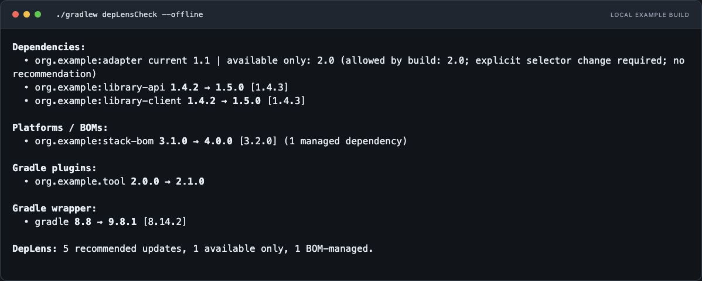
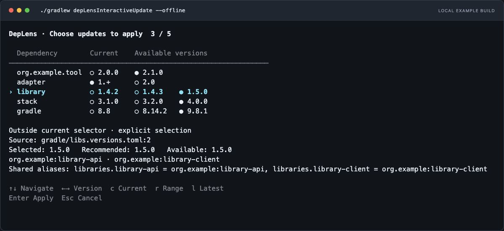

# DepLens

[](https://github.com/sneedit/deplens-gradle-plugin/actions/workflows/build.yml)
[](https://plugins.gradle.org/plugin/com.sneedit.deplens)
[](https://central.sonatype.com/artifact/com.sneedit.deplens/plugin)
[](https://github.com/sneedit/deplens-gradle-plugin/releases/latest)
[](https://github.com/sneedit/deplens-gradle-plugin/blob/main/plugin/build.gradle)
[](https://github.com/sneedit/deplens-gradle-plugin/blob/main/README.md#requirements)
[](LICENSE)

**[Website](https://deplens.sneedit.com) · [Configuration](https://deplens.sneedit.com/configuration/) · [Detailed reference](https://deplens.sneedit.com/reference/)**

DepLens checks **dependencies, BOMs/platforms, version constraints, Gradle plugins
and the Gradle wrapper** for newer versions. It resolves candidates with Gradle's
repositories and dependency rules, and can write selected versions back to catalogs,
properties and build scripts.

[Screenshots](#screenshots) · [Installation](#installation) · [Defaults](#default-configuration) · [Configuration](#configuration) · [FAQ](#faq)

## Screenshots

### Update check



Recommended versions passed the dependency checks. Available-only versions may
require changes to selectors, constraints or other build requirements.

### Interactive selection



A shared catalog version gets one choice for every dependency using it. All rows
start at Current; this capture shows the selection after pressing `r` (Range).
Both screenshots come from the actual plugin running against a local example
repository with fixed versions. The interactive run was cancelled without edits.

## Installation

Use DepLens `0.1.0` in your settings file. The settings plugin also applies DepLens
to the root project and enables settings-plugin checks.

```kotlin
// settings.gradle.kts
plugins {
    id("com.sneedit.deplens.settings") version "0.1.0"
}
```

<details>
<summary>Groovy DSL</summary>

```groovy
// settings.gradle
plugins {
    id 'com.sneedit.deplens.settings' version '0.1.0'
}
```

</details>

For the project plugin instead, use `com.sneedit.deplens` with
version `0.1.0` in `build.gradle.kts` or `build.gradle`. Use the settings entry point
when you need settings-plugin resolution context. With either entry point,
configure `depLens { ... }` in the root project's build script.

```sh
./gradlew depLensCheck              # report newer versions; no source edits
./gradlew depLensInteractiveUpdate  # select versions, then confirm or cancel
```

## Requirements

| DepLens | Gradle | Java | Interactive terminal |
| --- | --- | --- | --- |
| 0.1.0 | 8.8+ | 21+ | macOS or Linux |

Checks support Configuration Cache and Isolated Projects. Other plugins and build
logic must support them too. Custom resolution rules can prevent cache reuse;
DepLens reports when `--no-configuration-cache` is needed.

## Usage

| Task | Result |
| --- | --- |
| `depLensInventory` | Declarations, resolved versions, source locations and project/build origins |
| `depLensCheck` | Updates for dependencies, BOMs, constraints, plugins and the wrapper |
| `depLensCheckDependencies` | Dependency, BOM and version-constraint updates |
| `depLensCheckPlugins` | Gradle plugin updates |
| `depLensCheckGradle` | Gradle wrapper updates |
| `depLensInteractiveUpdate` | All checks followed by version selection and confirmed source edits |

Check and inventory tasks do not edit files. They print console results and write
JSON under `build/reports/deplens/`: `<taskName>.json` for checks and interactive
updates, `inventory.json` for inventory.

```sh
./gradlew depLensCheck --info      # source locations, contexts and failure reasons
./gradlew depLensCheck --offline   # cached dependency metadata; no remote wrapper feed
./gradlew depLensCheck --fast      # skip candidate dependency-graph checks
./gradlew depLensCheck --console-mode standard  # include project paths
```

Fast mode still applies version rules, but does not check candidate Java/variant
requirements or interactions with other dependencies, BOMs and constraints.
Its results are marked **build context not checked**.

## Default configuration

These are the defaults when you do not configure DepLens. This block is optional;
copy only the settings you want to change into `build.gradle.kts`.

```kotlin
depLens {
    consoleMode.set("compact")
    checkBuildContext.set(true)
    checkIncludedBuilds.set(true)
    checkBuildSrc.set(true)
    failIfChecksIncomplete.set(false)

    checkResolvableConfigurationFilter {
        includes.set(emptyList())
        excludes.set(emptyList())
    }
    outputDeclaredConfigurationFilter {
        includes.set(emptyList())
        excludes.set(emptyList())
    }
    dependencies {
        allowedUpdates.set("major")
        includePreReleases.set(false)
        failIfUpdatesFound.set(false)
        pinCurrentVersions.set(emptyList())
        ignoredVersions.set(emptyMap())
    }
    plugins {
        allowedUpdates.set("major")
        includePreReleases.set(false)
        failIfUpdatesFound.set(false)
        pinCurrentVersions.set(emptyList())
        ignoredVersions.set(emptyMap())
    }
    gradle {
        allowedUpdates.set("major")
        includePreReleases.set(false)
        failIfUpdatesFound.set(false)
        pinCurrentVersion.set(false)
        versionsUrl.set("https://services.gradle.org/versions/all")
    }
    rules { } // No scoped overrides by default.
}
```

<details>
<summary>Complete defaults in Groovy DSL</summary>

```groovy
depLens {
    consoleMode = "compact"
    checkBuildContext = true
    checkIncludedBuilds = true
    checkBuildSrc = true
    failIfChecksIncomplete = false

    checkResolvableConfigurationFilter {
        includes = []
        excludes = []
    }
    outputDeclaredConfigurationFilter {
        includes = []
        excludes = []
    }
    dependencies {
        allowedUpdates = "major"
        includePreReleases = false
        failIfUpdatesFound = false
        pinCurrentVersions = []
        ignoredVersions = [:]
    }
    plugins {
        allowedUpdates = "major"
        includePreReleases = false
        failIfUpdatesFound = false
        pinCurrentVersions = []
        ignoredVersions = [:]
    }
    gradle {
        allowedUpdates = "major"
        includePreReleases = false
        failIfUpdatesFound = false
        pinCurrentVersion = false
        versionsUrl = "https://services.gradle.org/versions/all"
    }
    rules { } // No scoped overrides by default.
}
```

</details>

`rules` is empty by default. Fields of a rule you add are initially unset, so they
inherit the broader policy. The optional fields are:

| Rule field | Without an explicit value |
| --- | --- |
| `pinned`, `includePreReleases`, `allowedUpdates` | Inherit the broader rule or section default |
| `ignoredVersions`, `ignoredVersionPatterns` | Inherit exclusions; no exclusions initially |
| `versionPattern` | Automatic numeric tier classification; calendar-date versions have unknown compatibility |
| `preReleasePattern` | Built-in detection of alpha, beta, RC, snapshot and other prerelease markers |
| `versionNormalizationPattern`, `versionNormalizationReplacement` | No normalization; configure both together |

## Configuration

### Allow patch or minor updates

```kotlin
depLens {
    dependencies { allowedUpdates.set("minor") }
    plugins { allowedUpdates.set("patch") }
    gradle { allowedUpdates.set("patch") }
}
```

| `allowedUpdates` | Examples starting from `1.4.2` |
| --- | --- |
| `patch` | `1.4.3`; same major and minor |
| `minor` | `1.4.3`, `1.5.0`; same major |
| `major` | All update levels, including `2.0.0` and unclassified versions |

These levels describe version numbering, not binary compatibility. Detected
prereleases remain excluded unless `includePreReleases` is enabled.

### Pin a dependency or ignore a version

```kotlin
depLens {
    rules {
        dependency("org.slf4j:slf4j-api") { pinned.set(true) }
        group("com.fasterxml.jackson.core") { allowedUpdates.set("patch") }
        plugin("org.jetbrains.kotlin.jvm") { ignoredVersions.set(listOf("2.2.0")) }
    }
}
```

This keeps `slf4j-api` at its current version, restricts the exact Jackson group to
patches and excludes Kotlin JVM plugin version `2.2.0` from candidates. Ignoring
one version does not pin the component; other allowed candidates remain eligible.

### Update a BOM

In a Java project, import the BOM and leave its managed dependencies versionless:

```kotlin
dependencies {
    implementation(platform("org.springframework.boot:spring-boot-dependencies:4.1.1"))
    implementation("org.springframework:spring-core")
}

depLens {
    rules {
        platform("org.springframework.boot:spring-boot-dependencies") {
            allowedUpdates.set("minor")
        }
    }
}
```

DepLens checks the BOM version. Dependencies managed only by that BOM follow its
version; DepLens does not insert separate versions into their declarations.

### Override a rule for one component

```kotlin
depLens {
    dependencies { allowedUpdates.set("major") }
    rules {
        group("org.example") { allowedUpdates.set("patch") }
        dependency("org.example:library") { allowedUpdates.set("minor") }
    }
}
```

Here `org.example:library` can receive minor updates while the rest of its group
is limited to patches. Precedence applies to each configured field:
**exact dependency / platform / plugin / Gradle > group > project > global > section defaults**.
Unset fields inherit; the later rule wins at equal specificity. Lists replace
inherited lists rather than append to them.

### Select builds and configurations

```kotlin
depLens {
    checkIncludedBuilds.set(true)
    checkBuildSrc.set(false)
    checkResolvableConfigurationFilter {
        includes.set(listOf(".*Classpath"))
        excludes.set(listOf("testRuntimeClasspath"))
    }
    outputDeclaredConfigurationFilter {
        excludes.set(listOf("testImplementation", "testRuntimeOnly"))
    }
}
```

This excludes `buildSrc` and checks configurations ending in `Classpath`, except
`testRuntimeClasspath`. The output filter hides entries declared only in the
listed test configurations; it does not skip checks or suppress CI failures.

Patterns are Java regular expressions matched against the whole name; exclusions
win. Analysis uses resolvable names such as `runtimeClasspath`; output uses
declaration names such as `runtimeOnly`.

### Fail CI when updates exist or checks are incomplete

```kotlin
depLens {
    failIfChecksIncomplete.set(true)
    dependencies { failIfUpdatesFound.set(true) }
    plugins { failIfUpdatesFound.set(true) }
    gradle { failIfUpdatesFound.set(true) }
}
```

```sh
./gradlew depLensCheck --configuration-cache
```

Reports are written before failure. `failIfUpdatesFound` includes available-only
versions; `failIfChecksIncomplete` covers incomplete inventory and selected
checks. These flags default to `false` and do not fail the interactive task.
Offline mode can leave checks incomplete when metadata is missing or the remote
wrapper feed is skipped.

## Interactive updates

```sh
./gradlew depLensInteractiveUpdate
```

| Key | Action |
| --- | --- |
| `↑` / `↓` | Move between version sources |
| `←` / `→` | Select a version for the focused source |
| `r` | Range: highest offered version accepted by the checks for each shared source |
| `l` | Latest: highest offered version permitted by all consumers' update rules |
| `c` | Reset all sources to Current |
| `Enter` | Apply selected edits |
| `Esc` / `Ctrl+C` | Cancel without editing |

In fast mode, Range selects from rule-allowed candidates without graph validation.
Dynamic selectors such as `1.+` stay at Current during bulk selection; arrow keys
can explicitly replace one with a fixed version.

DepLens can edit literal versions in catalogs (including `strictly`, `require` and
`prefer`), Gradle properties, script variables, dependency/plugin declarations and
wrapper distribution URLs. Existing wrapper SHA-256 checksums are updated for the
selected distribution. Comments, formatting, `bin`/`all` and custom mirrors are
preserved. Computed, generated or ambiguous sources stay read-only.

## FAQ

### Why is a version available but not recommended?

Gradle may reject it because of Java/variant requirements, constraints, peer
dependencies or the declaration's selector. DepLens can recommend an older
accepted candidate while keeping the newer version visible. Successful graph
resolution does not guarantee artifact availability, compilation or passing tests.

### Why can I not edit a shared catalog version?

A shared value affects every checked component using it. Their allowed candidates
must overlap. A pinned, failed or unchecked component prevents editing the shared
value. This also applies to consumers hidden by output filters.

### Are transitive dependencies updated separately?

No. They participate in Gradle's resolution checks but do not become independent
update entries. BOM-managed dependencies are updated through their BOM. Explicit
dependency versions and constraints are checked separately.

### Does applying updates run my build or tests?

No. DepLens checks for concurrent file changes and overlapping edits before
writing, but there is no post-update build, test run or automatic rollback. An I/O
failure can leave partial changes. Review the diff, then run your build:

```sh
./gradlew build
```

### Where do repositories and credentials go?

Use Gradle's `repositories`, `pluginManagement.repositories` and buildscript
repository blocks. DepLens uses the repositories and rules of the project or
plugin classpath being checked.

### Does the interactive task work on Windows or in CI?

The interactive terminal supports macOS and Linux and requires a terminal. Use
`depLensCheck` for unattended checks and CI; it writes reports without asking for
input or modifying sources.

## Examples and reference

- [Example builds](examples): Java, Kotlin DSL, multi-module and isolated composite builds.
- [Configuration](https://deplens.sneedit.com/configuration/): every option, supported rule scope and Kotlin/Groovy examples.
- [Behavior reference](https://deplens.sneedit.com/reference/): resolution details, version patterns, normalization and Gradle compatibility.
- [Changelog](CHANGELOG.md) · [Issues](https://github.com/sneedit/deplens-gradle-plugin/issues)

## Contribute

```sh
./gradlew build
./gradlew :plugin:test --tests 'com.sneedit.deplens.console.SourceEditorTest'
./gradlew :plugin:nullAway :plugin:validatePlugins
```

### Changelog generation

`CHANGELOG.md` is generated by
[GitHub Changelog Generator](https://github.com/github-changelog-generator/github-changelog-generator)
from stable release tags (`vX.Y.Z`), closed issues and merged pull requests.
Version headings include dates and comparison links; pending changes appear under
`Unreleased`. Release note bodies and individual commits are not imported.
Do not edit the generated file manually.

The **Update Changelog** workflow commits changes to the default branch after
pushes to `main`, issue changes and published/edited/deleted releases. It also
runs daily to pick up metadata changes and can be started with **Run workflow**.
The release workflow calls it explicitly after creating a release, because
events created with `GITHUB_TOKEN` do not start another workflow.

The workflow uses the built-in `GITHUB_TOKEN`; no additional secret is needed.
Repository rules must allow `github-actions[bot]` to push changelog commits to
the default branch. It only commits when the generated content changes.

Use `enhancement` for **Implemented enhancements**, `bug` for **Fixed bugs**,
and `breaking` for **Breaking changes**. Other closed issues and merged pull
requests appear in their own sections, with issue/PR links and PR authors.
Labels `duplicate`, `question`, `invalid`, `wontfix` and
`Meta: Exclude From Changelog` exclude entries. A milestone matching a release
tag can assign an issue to that release.

To regenerate locally with Ruby 3.4 and Bundler:

```sh
bundle config set --local path vendor/bundle
bundle install
# Set CHANGELOG_GITHUB_TOKEN in your environment to avoid anonymous API limits.
bundle exec github_changelog_generator
```

Generator settings are in [`.github_changelog_generator`](.github_changelog_generator);
the generator version and its dependencies are pinned in `Gemfile` and `Gemfile.lock`.

## License

Copyright 2026 Sneed IT. [Apache-2.0](LICENSE) · [NOTICE](NOTICE).
